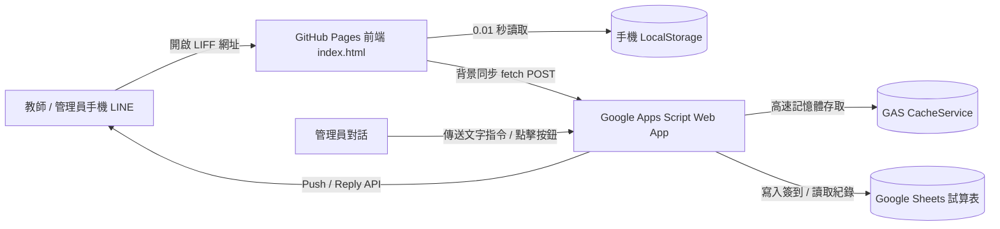
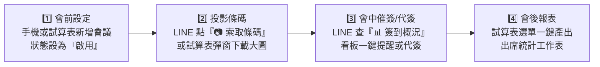

# 📱 學校智慧會議簽到系統 (LIFF + Google Apps Script + Google Sheets)

> 一套專為學校與機關設計的極速、分權、零維護成本的 LINE LIFF 會議簽到與管理系統。  
> 具備 **前端 LocalStorage「0 秒秒開」** 與 **後端 GAS CacheService「記憶體快取加速」**，並整合 **LINE Bot 管理員點擊式指令選單**。

### 🔗 快速導覽
* 📖 **給老師與主辦人看的操作手冊**：[USER_GUIDE.md（佈署後日常操作流程）](USER_GUIDE.md)
* 📦 **直接下載範本改一改就能用**：[templates/（含試算表 `.xlsx` 範本、`.csv` 與網頁範本）](templates/)
* 🤖 **請 AI 幫你自動佈署的規格書**：[AI_DEPLOYMENT_SPEC.md（AI 專用技術規格與提示詞）](AI_DEPLOYMENT_SPEC.md)

---

## 🌟 核心特色

### 1. ⚡ 極致效能體驗
* **前端 LocalStorage 0 秒秒開**：首次載入後自動記錄身分（姓名、職務、綁定狀態、管理權限），再次點開時 **0.01 秒內直接顯示個人化問候與介面外框**，完全無白畫面或轉圈等待感。
* **背景無感同步**：介面秒開的同時，背景非同步連線後端更新最新會議與簽到卡片狀態（綠色已簽到 / 橘色開放中）。
* **後端 CacheService 記憶體加速**：教師主名單與會議設定快取存於 Google Apps Script 記憶體中，將原本 1.5~2.5 秒的試算表 I/O 查詢降至 **0.3~0.5 秒**（減少 80% 延遲）。
* **倒序高效檢索（Bottom-Up Scan）**：今日簽到紀錄採從底層倒序掃描並提早中斷，即使歷史紀錄累積萬筆依然維持毫秒級判定。

### 2. 🔐 智慧身分與分權管理
* **首次身分綁定**：教師首次開啟僅需輸入真實姓名與末 3 位薪資識別碼，驗證通過後自動與 LINE User ID 綁定，無需繁瑣帳密。
* **最高系統管理員 vs. 各會議管理員分權**：
  * **最高系統管理員**：可由手機直接開啟「⚙️ 會議地點與時間設定」新增/編輯會議，並檢視所有場次。
  * **單場會議管理員**：僅能管理自己被指派的會議看板與代簽權限。
  * **一般教師**：僅顯示自身需要出席且目前開放簽到的會議場次。

### 3. 📷 雙重彈性簽到模式
* **📷 主力：相機掃描 QR Code**：直接呼叫 LINE 內建相機（LIFF `scanCodeV2`），對準現場投影布幕或紙本上的 QR Code 即刻完成核銷。
* **⌨️ 備援：文字驗證碼輸入**：若同仁手機鏡頭異常或現場反光，可直接輸入 4 位數現場會議驗證碼（Passcode）完成簽到。

### 4. 🤖 LINE Bot 管理員點擊式文字選單 (Quick Reply)
管理員在官方帳號聊天室中，**鍵盤上方會常駐一排點擊按鈕**，無需手動輸入指令即可秒速操作：
* `📷 索取條碼 (QR)`：立即接收今日開會場次的現場簽到 QR Code 圖片與驗證碼。
* `📊 簽到概況`：即時統計今日各場次應到人數、已簽到人數、缺席人數與出席百分比。
* `👥 未簽到名單`：列出尚未完成簽到的同仁名單（標示是否已綁定 LINE）。
* `🔄 清除快取`：手動清空 GAS 記憶體快取，立即重整 Google Sheets 最新變更。
* `📱 開啟管理看板`：一鍵直達手機管理員後台。

### 5. 📊 試算表擴充功能（Google Sheets 內建選單）
* **🏷️ 批次新增教師標籤**：彈窗勾選教師，一鍵批次新增「國一導師」、「英文科備課組」等身分標籤。
* **📷 產生會議驗證碼 QR Code**：直接在試算表彈窗產生大圖並支援下載。
* **📊 產生會議出席統計報表**：自動分析該會議應到/實到/缺席名冊，一鍵產生獨立的美化統計工作表。

---

## 🏗️ 系統架構



---

## 📂 專案檔案結構

```text
├── index.html                  # LIFF 前端單頁應用 (支援 LocalStorage 秒開)
├── Code.gs                     # 後端主程式 (API 路由、CacheService、LINE Webhook、試算表工具)
├── TagDialog.html              # 試算表內建視窗：批次設定教師職務標籤
├── QRCodeDialog.html           # 試算表內建視窗：會議驗證碼條碼預覽與下載
├── ReportDialog.html           # 試算表內建視窗：一鍵產生成果統計報表
├── USER_GUIDE.md               # 📖 一般使用者與管理員操作手冊 (佈署後流程)
├── AI_DEPLOYMENT_SPEC.md       # 🤖 給 AI 閱讀的系統規格書與自動佈署指令
├── README.md                   # 專案說明文件與部署教學
└── templates/                  # 📦 可直接下載修改的範本資料夾
    ├── 學校會議簽到系統_試算表範本.xlsx  # 一鍵匯入 Google Sheets 的 5 分頁整合範本
    ├── index.template.html             # 含參數佔位符的前端網頁範本
    ├── 教師主名單.csv
    ├── 會議地點與時間設定.csv
    ├── 簽到紀錄.csv
    ├── 管理員名單.csv
    └── 系統參數.csv
```

---

## 📦 下載範本（有興趣的人可直接下載自行修改）

不想自己從零建試算表欄位嗎？您可以直接下載 [`templates/`](templates/) 資料夾中的範本：

1. **Google 試算表完整範本（最推薦）**：
   * 下載 [`templates/學校會議簽到系統_試算表範本.xlsx`](templates/%E5%AD%B8%E6%A0%A1%E6%9C%83%E8%AD%B0%E7%B0%BD%E5%88%B0%E7%B3%BB%E7%B5%B1_%E8%A9%A6%E7%AE%97%E8%A1%A8%E7%AF%84%E6%9C%AC.xlsx)
   * 上傳至您的 Google 雲端硬碟 → 點兩下開啟 → 點選上方 **「檔案」>「另存為 Google 試算表」**，即可一次獲得設定好欄位、格式與範例資料的 5 個工作表！
2. **單一工作表 CSV 範本**（UTF-8 BOM 編碼，Excel 與試算表皆不亂碼）：
   * [`教師主名單.csv`](templates/%E6%95%99%E5%B8%AB%E4%B8%BB%E5%90%8D%E5%96%AE.csv) | [`會議地點與時間設定.csv`](templates/%E6%9C%83%E8%AD%B0%E5%9C%B0%E9%BB%9E%E8%88%87%E6%99%82%E9%96%93%E8%A8%AD%E5%AE%9A.csv) | [`簽到紀錄.csv`](templates/%E7%B0%BD%E5%88%B0%E7%B4%80%E9%8C%84.csv) | [`管理員名單.csv`](templates/%E7%AE%A1%E7%90%86%E5%93%A1%E5%90%8D%E5%96%AE.csv) | [`系統參數.csv`](templates/%E7%B3%BB%E7%B5%B1%E5%8F%83%E6%95%B8.csv)
3. **乾淨前端網頁範本**：
   * 下載 [`templates/index.template.html`](templates/index.template.html)，替換其中的 `MY_LIFF_ID` 與 `GAS_WEB_APP_URL` 並重新命名為 `index.html` 即可部署。

---

## 🤖 使用 AI 快速佈署（給想請 AI 幫忙的人）

本專案提供專為 AI 助手設計的技術規格書：[**`AI_DEPLOYMENT_SPEC.md`**](AI_DEPLOYMENT_SPEC.md)。  
只要將本專案匯入您的 AI 工具（Antigravity、Cursor、Claude、ChatGPT 等），並貼上以下指令：

```text
請閱讀這個專案的 AI_DEPLOYMENT_SPEC.md 與 README.md，一步步引導我輸入自己的 Google 試算表、GAS Web App URL、LINE Bot Token 與 LIFF ID，幫我修改檔案並完成部署與測試。
```

---

## 📑 Google 試算表工作表設定指南

本系統依賴於一份 Google 試算表，請建立以下 5 個工作表頁籤：

### 1. `教師主名單`
| A: 教師姓名 | B: 薪資識別碼 (末3碼) | C: LINE User ID | D: 綁定狀態 | E: 綁定時間 | F: 職務/群組標籤 |
| :--- | :--- | :--- | :--- | :--- | :--- |
| 王小明 | 123 | U12345678... | 已綁定 | 2026/10/15 08:30:00 | 教務處, 導師 |
| 李大華 | 456 | | 未綁定 | | 總務處 |

### 2. `會議地點與時間設定`
| A: 會議名稱 | B: 簽到日期/星期 | C: 開始時間 | D: 結束時間 | E: 現場驗證碼 | F: 啟用狀態 | G: 應到對象 | H: 會議管理員 |
| :--- | :--- | :--- | :--- | :--- | :--- | :--- | :--- |
| 教務處處務會議 | 週五 | 08:00 | 12:00 | 9527 | 啟用 | 教務處 | 李孟真, 王小明 |
| 全校校務會議 | 2026/11/10 | 13:30 | 16:30 | 8888 | 啟用 | 全體 | 王大同 |

### 3. `簽到紀錄`
由系統自動寫入簽到紀錄，欄位順序如下：
* `A: 簽到時間` | `B: 會議名稱` | `C: 教師姓名` | `D: LINE User ID` | `E: 簽到狀態` | `F: 驗證訊息` | `G: 備註1` | `H: 備註2` | `I: 簽到方式`

### 4. `管理員名單`
| A: 管理員姓名 | B: LINE User ID (最高系統管理員) |
| :--- | :--- |
| 盧志雄 | U9876543210abcdef... |

### 5. `系統參數`
| A: 參數名稱 | B: 參數值 |
| :--- | :--- |
| `ADMIN_CONTACT_NAME` | 盧志雄 校長 |
| `ADMIN_CONTACT_PHONE` | 02-12345678 #101 |
| `LINE_CHANNEL_ACCESS_TOKEN` | 貼上 LINE Messaging API Channel Access Token |
| `LIFF_ID` | 貼上您的 LIFF ID (例如 2011810210-ESVfHIBL) |

---

## 🚀 部署指南 (Step-by-Step)

### 第一步：Google Apps Script (GAS) 部署
1. 打開您的 Google 試算表，點擊上方選單 **「擴充功能」 > 「Apps Script」**。
2. 將本專案中的檔案新增至 Apps Script 編輯器：
   * 建立指令碼檔案 `Code.gs`，將本地 `Code.gs` 完整內容貼上。
   * 分別建立 3 個 HTML 檔案：`TagDialog.html`、`QRCodeDialog.html`、`ReportDialog.html`，並貼入對應內容。
3. 點擊右上角 **「部署」 > 「新增部署作業」**：
   * 種類選擇：**「網頁應用程式 (Web App)」**。
   * 執行身分：選擇 **「我」 (您的帳號)**。
   * 誰可以存取：選擇 **「所有人 (Anyone)」**（**重要！**否則 LIFF 與 Webhook 無法連線）。
4. 點擊「部署」，完成權限授權，並複製產生的 **網頁應用程式網址 (GAS Web App URL)**。

---

### 第二步：LINE Developers 設定 (LIFF & LINE Bot)
1. 前往 [LINE Developers Console](https://developers.line.biz/) 並登入。
2. **設定 LINE Messaging API (LINE Bot)**：
   * 在「Messaging API」頁籤中產生 **Channel access token (long-lived)**。
   * 將此 Token 填入 Apps Script **「專案設定 > 指令碼屬性」**，屬性名稱 `LINE_CHANNEL_ACCESS_TOKEN`（建議，能看試算表的人就看不到 Token）；或沿用舊做法填入試算表 `系統參數` 的同名欄位。
   * 在「Webhook URL」貼上剛才第一步獲得的 **GAS Web App URL**，開啟「Use webhook」。
3. **設定 LINE LIFF App**：
   * 新增一個 LIFF App，取得 **LIFF ID**。
   * **Endpoint URL** 填入您的 GitHub Pages 網址（例如：`https://huahua718-creator.github.io/liff-checkin/`）。
   * **Size** 選擇 `Full` 或 `Tall`。
   * **Scope** 勾選 `profile`、`openid`。
   * **Scan QR** 權限勾選 `ON`。

---

### 第三步：設定前端程式碼並發布至 GitHub Pages
1. 開啟專案中的 [`index.html`](index.html)，搜尋並確認前兩行設定：
   ```javascript
   const MY_LIFF_ID = "您的_LIFF_ID";
   const GAS_WEB_APP_URL = "您的_GAS_WEB_APP_URL";
   ```
2. 推送至 GitHub 儲存庫 `liff-checkin`。
3. 進入 GitHub Repository 的 **Settings > Pages**：
   * Branch 選擇 `main`，資料夾選擇 `/ (root)`，點擊 Save。
   * 幾秒後即可獲得專屬的 GitHub Pages 網址。

---

## 🔐 安全性設計

| 項目 | 做法 |
| :--- | :--- |
| 身分驗證 | 前端每次呼叫都附上 `liff.getIDToken()`，後端向 LINE `oauth2/v2.1/verify` 驗證後才採信 userId；前端傳來的 `myLineUserId` 一律忽略。**LIFF Scope 必須勾選 `openid`。** |
| Channel ID | 驗證 ID Token 需要 LINE Login Channel ID，系統會自動取 `LIFF_ID` 中「-」前面的數字；如不同，可在 `系統參數` 或指令碼屬性新增 `LINE_LOGIN_CHANNEL_ID`。 |
| 管理權限 | 管理員看板、代簽、發送提醒都會在後端檢查「是否為該會議管理員或最高管理員」；提醒對象由後端依未簽到名單計算，不接受前端指定任意 LINE ID。 |
| 現場驗證碼 | 一般教師的 API 回應不再包含驗證碼，只有會議現場的 QR Code / 投影才看得到。 |
| 防暴力嘗試 | 綁定失敗：每個 LINE 帳號 1 小時 5 次、每個姓名 1 小時 10 次；驗證碼錯誤：每個帳號 10 分鐘 10 次。 |
| 資料一致性 | 簽到、代簽、綁定使用 `LockService` 避免同時寫入造成重複紀錄；同一 LINE 帳號只能綁定一位教師。 |
| 機敏設定 | `getSystemSetting()` 會先讀取指令碼屬性，再退回試算表 `系統參數`。 |

> ⚠️ **更新程式後務必重新部署**：Apps Script「部署 > 管理部署作業 > 編輯 > 版本：新版本」，否則網址仍執行舊程式碼。
>
> ℹ️ **已知限制**：GAS `doPost` 無法讀取 HTTP 標頭，因此無法驗證 LINE Webhook 的 `X-Line-Signature`。目前 Bot 指令只透過 replyToken 回覆，偽造的事件拿不到任何資料，但若未來要加入會寫入資料的 Bot 指令，建議改用 Cloud Functions 等可讀標頭的中介層。

---

## 🧑‍🤝‍🧑 佈署完畢後的日常操作流程（給一般使用者與管理員）

> 完整圖文說明與細節請參閱：[**📖 USER_GUIDE.md（一般人專用操作手冊）**](USER_GUIDE.md)

### 1. 一般教師（參加會議者）
1. **首次綁定（只需做一次）**：點開學校 LINE 官方帳號選單 → 輸入「真實姓名」與「薪資識別碼末 3 碼」→ 完成綁定。
2. **日常簽到（0 秒秒開）**：
   * 打開頁面即瞬間顯示您的姓名與今日會議卡片（🟠 橘色代表待簽到、🟢 綠色代表已完成）。
   * 點擊 **「📷 掃描現場 QR Code 簽到」** 掃描現場條碼，或點 **「⌨️ 輸入驗證碼簽到 (備援)」** 輸入 4 碼數字即可完成簽到。

### 2. 會議主辦人 / 管理員（開會標準流程 SOP）


* **小提示（取得最高管理員 LINE ID）**：首次佈署後，管理員只要先用一般教師身分完成一次綁定，再到試算表 `教師主名單` 複製自己的 **C 欄（`U` 開頭的 LINE User ID）** 貼到 `管理員名單` B 欄並清除快取，即可立刻解鎖最高管理員與 LINE Bot 選單權限！

---

## 💡 常見問題與管理員操作指南

1. **若我在 Google Sheets 修改了教師職務或開會時間，多久會生效？**
   * 系統快取時間為 **20 分鐘**，會自動重新載入。
   * 若需**立即生效**，只要在 Google 試算表上方點擊選單 **「會議管理功能」 > 「🔄 清除系統快取 (重載設定)」**，或在 LINE Bot 中點擊 **`[🔄 清除快取]`**，即刻同步！
2. **同仁換手機或換 LINE 帳號怎麼辦？**
   * 若同仁使用新 LINE 帳號開啟，前端會自動偵測 LINE ID 不一致並清除舊快取，要求重新驗證綁定。
   * 管理員亦可直接至 `教師主名單` 工作表清除該教師的 C 欄（LINE ID）與 D 欄（設為未綁定）。

---

## 📄 License
MIT License

